<p align="center">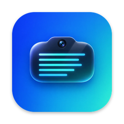</p>

# PeekPrompt

[](https://github.com/Amna29Mubashar/PeekPrompt/actions/workflows/build.yml)

A teleprompter that lives in your MacBook's notch, right under the camera, so you look straight at your audience while you read.

<p align="center">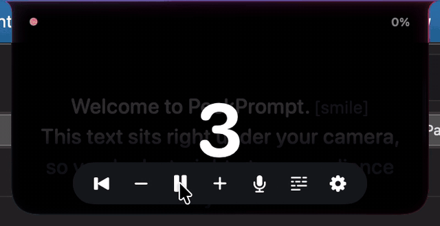</p>

## Features

- **Sits under the notch.** It tucks into the notch with the same curved "ears", and slides down when shown.
- **Three scrolling modes**
  - **Classic:** scrolls at a steady speed you choose.
  - **Voice-Activated:** scrolls only while you're speaking, and pauses when you go quiet or mute the mic. Turn on **Auto speed** and it matches how fast you talk.
  - **Word Tracking:** listens to the words you say and follows along, even if you skip ahead. Words you've read fade back. Uses Apple's speech recognition, on-device when your Mac supports it.
- **Voice-reactive glowing border.** A rotating gradient outline that brightens and thickens as you talk. Four color palettes.
- **Hidden from screen sharing.** It stays out of Zoom, Meet, Teams, QuickTime and screenshots (see the note on Loom below).
- **Put it anywhere.** Prefer it somewhere else? Switch Position to "Anywhere" and drag it. It becomes a rounded card and remembers where you left it.
- **Right-click menu** for play, restart, position, hide, Settings and Quit.
- **Script library with folders.** Drag scripts into any order. That order is also the play queue.
- **End of script:** stop, start over, or move straight on to the next script.
- **Presentation mode.** One slide at a time. PowerPoint speaker notes import slide by slide, and you switch slides with a shortcut, the hover buttons, your phone or Siri.
- **Memorize mode.** Practice a paragraph at a time while words are gradually hidden, down to first letters only.
- **Magic Polish.** Rewrite rough notes into a natural, spoken-style script with Apple Intelligence, on your Mac.
- **Dictation.** Speak your script and it's typed for you.
- **Import** .txt, .md, .rtf, Word (.docx), **PDF**, or the **speaker notes from a PowerPoint** (.pptx).
- **3-2-1 countdown** before you start.
- **Pacing timer.** Set a target length and see whether you're ahead or behind.
- **Reading-line highlight.** The line you're reading is bright, and the rest is dimmed.
- **Fonts and themes.** Rounded, standard, serif, monospaced or **OpenDyslexic**, in dark or light, with adjustable background opacity.
- **Hands-free start.** Press ⇧⌘Space, or say "Hey Siri, start PeekPrompt". Also available in the Shortcuts app.
- **10 languages:** English, Spanish, French, German, Italian, Portuguese (Brazil), Japanese, Korean, Chinese (Simplified) and Arabic.
- **Phone remote.** Scan a QR code and control play, speed and more from your phone's browser (same Wi-Fi). No app needed.
- **Hover to pause**, and scroll with your trackpad to jump around.
- **Cues.** Anything in `[square brackets]` is dimmed and italic, so you know not to read it aloud.
- **Global shortcuts** that work from any app.
- **Live mic meter** in Settings, so you can tune voice sensitivity to your room.
- **Private.** No accounts, no tracking, and recordings are never saved. Voice levels are measured on your Mac. Word Tracking and Dictation use Apple's speech recognition, which runs on-device when your Mac supports it.

## How to use

### Getting started
After launch, PeekPrompt slides down from your notch with a sample script. There's no Dock icon. Everything is on the prompter itself:
- **Hover** over the prompter to show the controls: restart, slower, play/pause, faster, mute, switch mode, and ⚙️ Settings.
- **Right-click** the prompter for a quick menu: play, restart, move, switch script, hide, Settings and Quit.
- There's also a menu bar icon, but on crowded MacBook menu bars macOS may hide it behind the notch.

### Writing and managing scripts
<p align="center">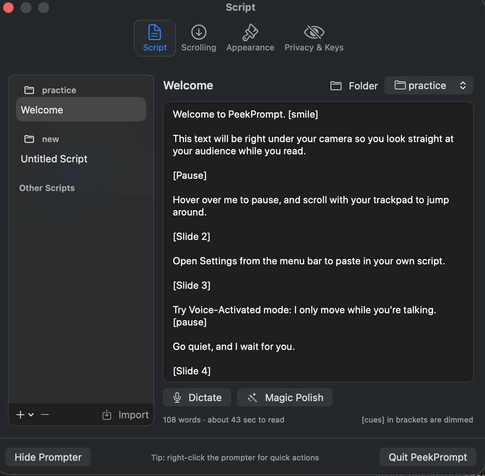</p>

Open **Settings → Script**.
- The list on the left is your **script library**. Click **+** to add a script, **−** to delete one, or right-click a script to duplicate it.
- Rename a script by editing the title above the text.
- Put stage directions in square brackets, like `[pause]` or `[smile]`. They show dimmed and italic, so you know not to read them out.
- The footer shows the word count and roughly how long the script takes to read, at about 150 words per minute.
- Switch scripts any time by right-clicking the prompter → **Script**.

### Dictation and Magic Polish
- **Dictate:** click **Dictate** under the editor and start talking. Your words are added to the end of the script. Click **Stop Dictating** when you're done.
- **Magic Polish:** click **Magic Polish** to rewrite the script so it's easier to say out loud. You can make it sound natural, make it shorter, or turn rough notes into a script. Nothing changes until you choose **Replace Script** or **Save as New Script**. On Macs with Apple Intelligence (macOS 26 or later) the rewrite runs on-device. On other Macs, a basic cleanup removes formatting and spells out shorthand like "e.g." and "%".

### Folders and the play queue
Click **+** → **New Folder…** to group scripts. Right-click a script → **Move to Folder**, and drag scripts to reorder them. The order in the list is the play queue: set **Settings → Scrolling → At the end of a script** to **Play the next script** to read several scripts back to back.

### Importing a script
Click **Import** at the bottom of the script list and pick one or more files:
- **Text and Markdown** (.txt, .md), **Rich Text** (.rtf), **Word** (.docx, .doc), **OpenDocument** (.odt) or **web pages** (.html)
- **PDF** (.pdf): the text of every page
- **PowerPoint** (.pptx): PeekPrompt pulls out the **speaker notes** for each slide, in order, with a `[Slide N]` cue between them. If a slide has no notes, it uses the text on the slide.

Each file becomes a new script named after the file.

### Choosing how it scrolls
<p align="center">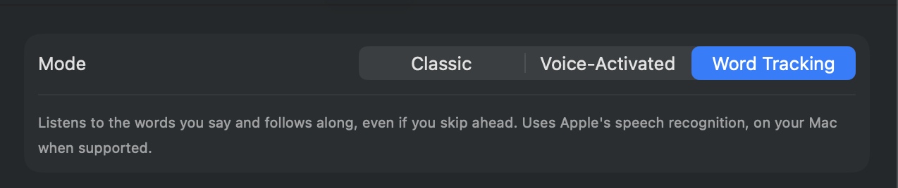</p>

Open **Settings → Scrolling**, or click the mode button in the hover controls to cycle through the modes.

| Mode | Best for | How it works |
|---|---|---|
| **Classic** | Steady reading, rehearsals | Scrolls at the speed you set. Use − and + while reading, or ⌃⌥↑ / ⌃⌥↓. |
| **Voice-Activated** | Natural talks with pauses | Moves only while you're speaking and waits when you stop. Turn on **Auto speed** and it measures your words per minute and matches it. |
| **Word Tracking** | Reading word for word | Listens to *what* you say and keeps your place, even if you skip a line. Words you've already said fade back. |

<p align="center">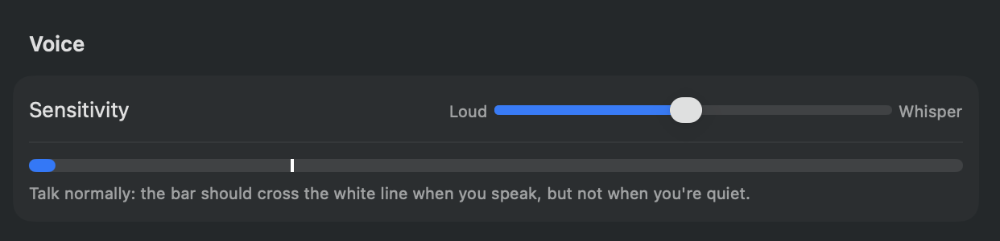</p>

**Tuning voice detection:** in Settings → Scrolling, watch the live mic bar while you talk. It should cross the white line when you speak and stay below it when you're silent. If it doesn't, move **Sensitivity** toward Whisper or Loud.

**Word Tracking** uses Apple's speech recognition. When your Mac supports it, it runs entirely on-device. The first time, macOS asks for permission.

### Presenting slides and memorizing
<p align="center">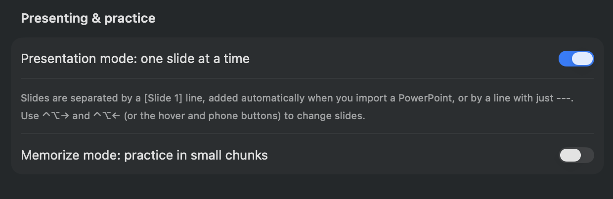</p>

In **Settings → Scrolling → Presenting & practice**:
- **Presentation mode** shows one slide at a time. Slides are separated by a `[Slide 1]` line, added automatically when you import a PowerPoint, or by a line with just `---`. Move between slides with **⌃⌥→ / ⌃⌥←**, the arrows in the hover controls, the phone remote, or Siri ("Next slide in PeekPrompt"). The area beside the notch shows "Slide 2/8".
- **Memorize mode** shows one paragraph at a time and hides words: some, most, or all but first letters. Raise the level as you learn the script. In Word Tracking mode, hidden words reappear as you say them.

### Before you start: countdown and pacing
<p align="center">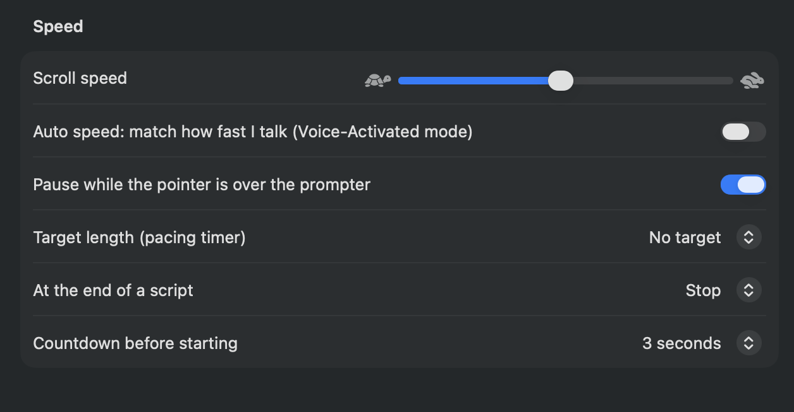</p>

- **Countdown:** pressing Play from the top shows 3… 2… 1… first, so you have time to look at the camera. Change it to 5 or 10 seconds, or turn it off, in Settings → Scrolling.
- **Pacing timer:** set a **Target length**, for example 2 min. The area to the right of the notch then shows elapsed time against your target, and whether you're **on time** (green), **behind** (orange) or **ahead** (blue).

### Making it comfortable to read
<p align="center">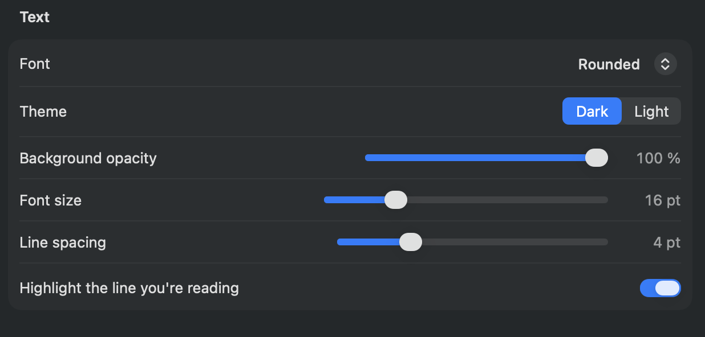</p>

Open **Settings → Appearance**.
- **Font:** Rounded, Standard, Serif, Monospaced, or **OpenDyslexic**, which is designed for readers with dyslexia.
- **Theme:** Dark or Light.
- **Background opacity:** lower it to see what's behind the prompter.
- **Font size, line spacing, width and height.**
- **Highlight the line you're reading:** the current line is full brightness and the rest is dimmed, so your eyes don't wander.

<p align="center">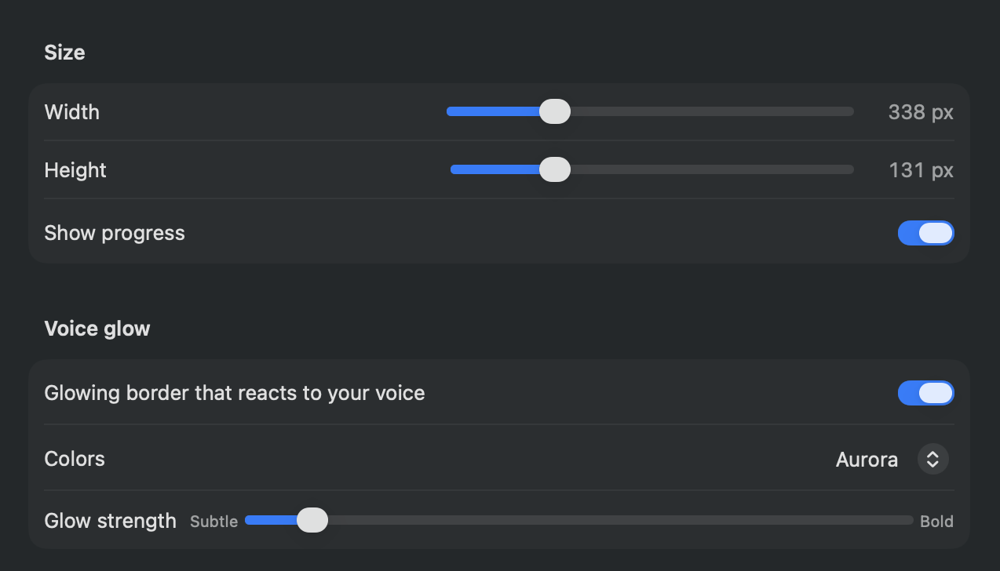</p>

- **Voice glow:** a gradient border that brightens and thickens as you talk. Choose a color set and adjust **Glow strength**.

### Moving the prompter
<p align="center">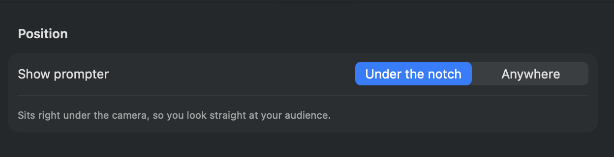</p>

By default it sits right under the camera for the best eye contact. To put it somewhere else, go to **Settings → Appearance → Position → Anywhere**, or right-click → **Move Anywhere**, then drag it. It remembers where you leave it. **Reset Position** or **Move Back Under Notch** undoes it.

### Controlling it from your phone
1. Go to **Settings → Privacy & Keys → Phone remote** and turn it on.
2. Scan the QR code with your phone's camera. Your phone must be on the **same Wi-Fi** as your Mac.
3. You get big buttons for play/pause, restart, back/ahead, slower/faster, mode, mute and show/hide, plus a progress bar.

<p align="center">
  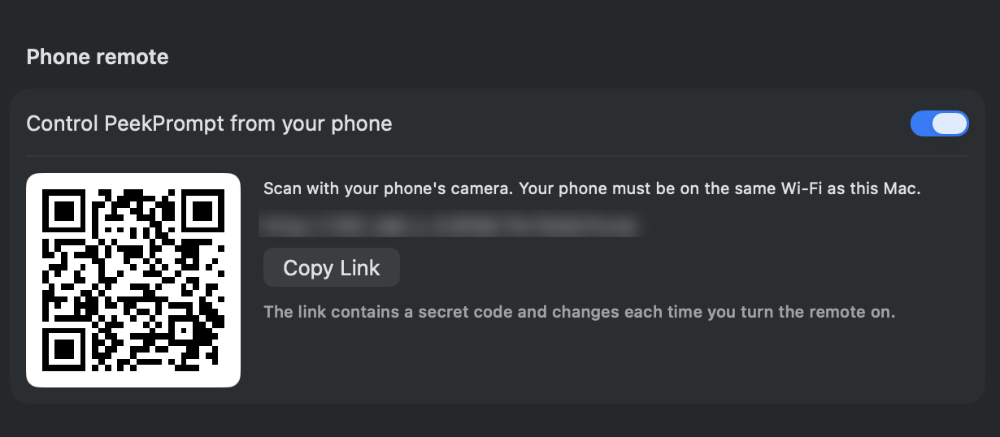
  &nbsp;&nbsp;
  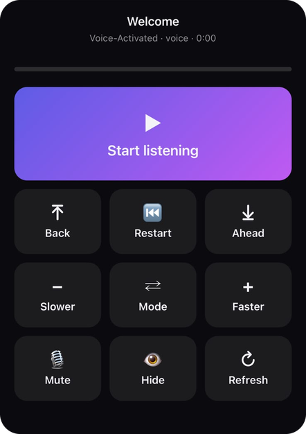
</p>

The link contains a secret code that changes every time you turn the remote on, so nobody else on the network can control your prompter. macOS may ask to let PeekPrompt find devices on your local network; allow it.

### Hiding it from recordings
**Settings → Privacy & Keys → Hide prompter from screenshots, screen sharing and recordings** is on by default. See the note on Loom below.

## Keyboard shortcuts

<p align="center">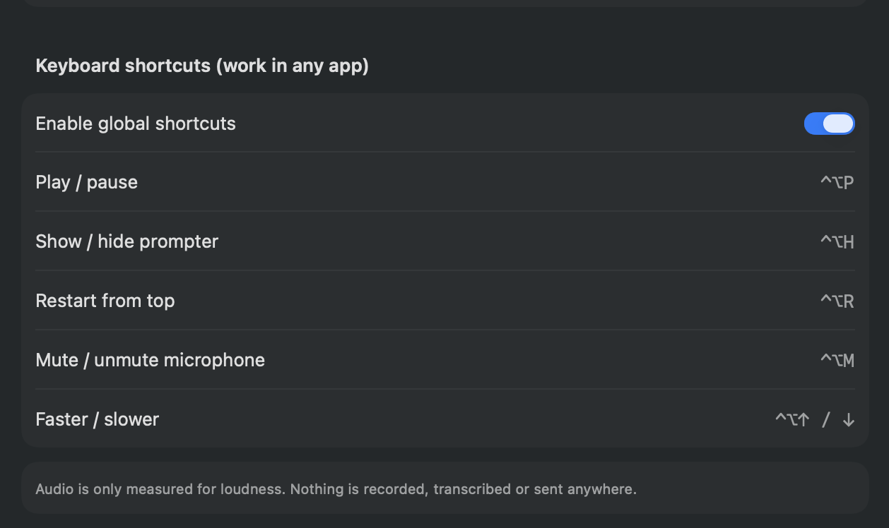</p>

| Shortcut | Action |
|---|---|
| ⌃⌥P | Play / pause |
| ⌃⌥H | Show / hide |
| ⌃⌥R | Restart from top |
| ⌃⌥M | Mute / unmute mic |
| ⌃⌥↑ / ⌃⌥↓ | Faster / slower |
| ⌃⌥→ / ⌃⌥← | Next / previous slide or chunk |
| ⇧⌘Space | Start / pause (hands-free) |

## A note on Loom and other recorders

PeekPrompt asks macOS to leave its window out of captures (`NSWindow.sharingType = .none`). Zoom, Meet, Teams, QuickTime and the screenshot tool all respect that.

Starting with **macOS 15.4**, recorders built on Apple's ScreenCaptureKit (Loom's full-screen mode is one) can still capture the window. Apple has confirmed there's currently no public API to prevent this, so no notch teleprompter can fully guarantee it.

**Workaround:** in Loom, choose **Camera only** or record a **single window** instead of your full screen. The prompter then never appears in your video.

## Build from source

Requirements: macOS 14 Sonoma or later and Xcode 16 or later.

1. Open `PeekPrompt.xcodeproj` in Xcode.
2. Select the **PeekPrompt** target, open **Signing & Capabilities**, and choose your Team. A free personal Apple ID works.
3. Press **⌘R**. The app appears in the menu bar, and macOS asks for microphone access the first time.

If the project file ever gives you trouble, you can regenerate it with XcodeGen:

```bash
brew install xcodegen
xcodegen generate
```

## Project structure

| File | What it does |
|---|---|
| `Segments.swift` | Splitting scripts into slides and memorize chunks |
| `MagicPolish.swift` | Magic Polish (Apple Intelligence rewrite and fallback) |
| `Dictation.swift` | Speak-to-type in the script editor |
| `AppIntents.swift` | Siri and Shortcuts actions |
| `*.xcstrings` | Translations for 10 languages |
| `PeekPromptApp.swift` | App entry, menu bar menu, global shortcuts setup |
| `PrompterWindowController.swift` | The floating notch window: position, slide animation, capture hiding |
| `PrompterView.swift` | What you see: the script, fades, progress, hover controls |
| `ScrollEngine.swift` | Moves the text 60 times a second, in Classic or Voice mode |
| `MicrophoneMonitor.swift` | Measures voice loudness and detects when you're speaking |
| `GlowBorder.swift` | The voice-reactive animated border |
| `NotchShape.swift` | The notch-style outline |
| `SettingsView.swift` | The Settings window |
| `PrompterSettings.swift` | All settings, saved automatically |
| `GlobalHotKeys.swift` | Shortcuts that work in any app |
| `SpeechTracker.swift` | Word Tracking and Auto speed (speech recognition and matching) |
| `ScriptImporter.swift`, `ZipReader.swift` | Importing documents and PowerPoint notes |
| `RemoteServer.swift` | The phone remote web page and server |
| `Typography.swift` | Fonts and themes |

## Fonts

OpenDyslexic is bundled under the SIL Open Font License (see `PeekPrompt/Fonts/OpenDyslexic-OFL.txt`).

## Credits

Inspired by [NotchPrompter](https://github.com/jpomykala/NotchPrompter) by Jakub Pomykała and [Textream](https://github.com/f/textream) by Fatih Kadir Akın. Both are MIT licensed. PeekPrompt is an independent implementation.

## License

MIT. See [LICENSE](LICENSE).
